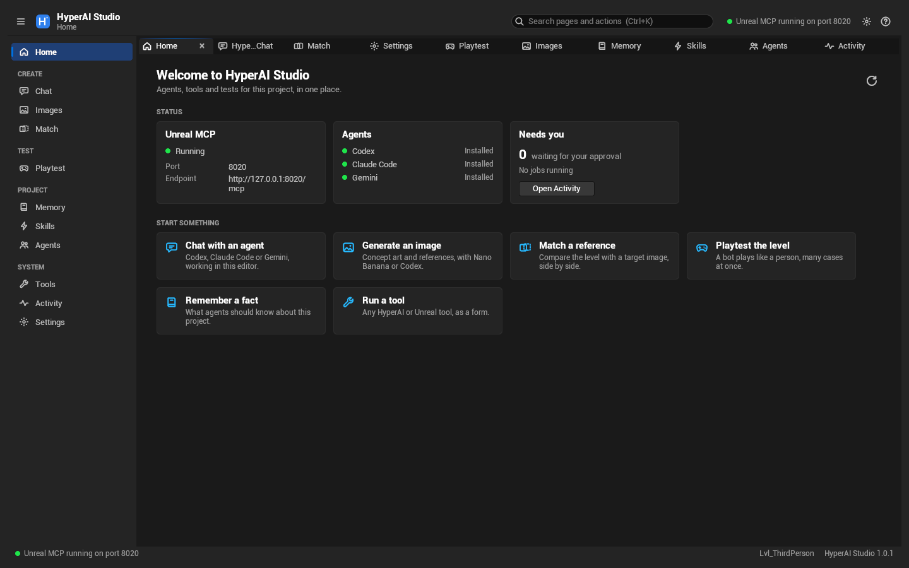

# HyperAI Studio Extended

**A studio of AI agents inside Unreal Engine 5.8.** Claude Code, Codex, Gemini and eight more agents work in your editor
like a team: planning, building, lighting, testing and checking their own work, through Epic's Unreal MCP. Every edit is
planned, approved, journaled and undoable.



**Documentation:** [epicnav.github.io/HyperAIStudio_Extended](https://epicnav.github.io/HyperAIStudio_Extended/), the same
pages the editor shows on the Studio's *Docs* page (also readable offline at `Docs/index.html`).

Built on [HyperAI Studio](https://gamesbyhyper.com/docs/project-foundations/hyper-ai-studio/), the free plugin by
Games by Hyper that set up Unreal MCP for external agents. This repository extends it far beyond that base; see
[Credits](#credits).

| | |
|---|---|
| **Engine** | Unreal Engine 5.8, Windows 64-bit, editor only (never in a packaged game) |
| **Tools** | 219 HyperAI tools in 42 capability packs, plus 21 of Epic's 5.9 toolsets ported to 5.8 |
| **Agents** | 11 in one chat, three direct API agents, an 8-role team |
| **Content** | 33 skills, 551 prompt presets, English and Simplified Chinese (4,557 strings) |

## What it does

### Agents and chat
- **One chat, every agent.** Claude Code, Codex, Gemini, GitHub Copilot, Cursor Agent, OpenCode, Goose, Qwen Code, Kimi,
  Auggie and Cline in HyperAI's own chat view, with transcripts, plans, approvals, pictures and reports; up to four
  chats side by side. Models on your own machine through Ollama and LM Studio.
- **Direct API agents.** Claude API, OpenAI API and Gemini API call the provider with your key and run their own tool
  loop over Unreal MCP, project files and approved commands. No CLI to install. Native chat or an interactive
  terminal share one conversation. See [API setup](Docs/api-authentication.md).
- **Keys never in the project.** Keys live in Windows Credential Manager (or the environment variable a service names)
  and reach an agent only as an environment variable of the process HyperAI starts.
- **A studio team.** One switch sends a request to a director, programmer, level designer, lighting artist,
  technical artist, UI designer, cinematographer and QA tester. Parts build in parallel; QA proves each one, and
  failures go back to the builder.
- **Skills and memory that run themselves.** Each message carries the project skills and memory that match it;
  agents save what they learn, notes that read like instructions are held for you.
- **Prompt presets.** 551 ready-made requests across every pack, each ending in the preview or analysis loop that
  proves the result.

### Safety
- **Approvals.** Agent edits wait in *Activity*, run as one undo step and are journaled, so a retry never applies twice.
  Sandbox Mode holds every save until you approve; destructive tools always ask.
- **Auto-approval** you turn on after a warning, for the categories and time you choose (an hour, 8 hours, custom, or a
  typed command), with an approval limit up to 10,000 and a stop after three failures in a row.
- **Source control.** Edits check assets out (Perforce, Plastic, Git) or lock them in Lore, and submit once you approve.
  *Settings › Version control* sets a project up with Lore.
- **Restart and resume.** Agents restart the editor themselves after a C++ change and pick the chat up where it left
  off. After a crash, HyperAI sends the crash report, reopens the editor and resumes the chats; agents keep running while
  the editor is down.
- **Bypass warnings.** HyperAI warns about MCP servers and editor plugins that change the editor outside its approval
  gate.

### 219 tools, 42 packs
Blueprints (including timelines, interfaces, RPCs and replication, collapsed graphs, tidy layout), levels and World
Partition, landscapes and PCG, lighting and look development, materials, Niagara (recipes, discovery, previews),
animation, Anim Blueprints, retargeting, Pose Search, motion warping, GAS, Enhanced Input, AI, EQS, UMG, cinematics and
Movie Render Queue, networking, data and localization, physics and destruction, Geometry Script modelling (with a
Modeling Mode hand-off), audio and MetaSounds, profiling, automation and more. Every tool is also a form you can run
yourself on the *Tools* page.

### Epic's 5.9 toolsets on 5.8
21 toolsets from Unreal 5.9 run on 5.8 without engine edits: Console and logs, Cheats, NavMesh, Config settings, Game
Features, Gameplay Tags, Plugins, Live Coding, GAS, AI, MVVM (31 tools), Slate inspector (30 tools, guarded so it
cannot drive HyperAI's own window), Widget animation and analysis, Texture Graph, Perf, Rewind Debugger, Input, World
Conditions and Data Registry. The compat layer and every edit are documented in
[`Source/Epic59/PORTING.md`](Source/Epic59/PORTING.md).

### Make things
- **Match a reference.** Give the *Match* page a picture; your agent lights or builds the level and HyperAI scores every
  attempt until it matches. Ultra Dynamic Sky is edited through its own variables.
- **Images** from Nano Banana, Codex or any model you configure, from presets.
- **3D models** from Tripo, Meshy and Hi3D: textured, checked and fixed in engine, rigged, animated, retextured up to 8K
  and retargeted onto your Mannequin; weapons get AAA finishing.
- **Sound design with Decibel**, built the way a sound designer layers it: sound-library takes, sampler instruments,
  a shared convolution room on reverb returns, automation lanes, reversed and granular clips, seamless loops, rendered
  into SoundWaves and MetaSounds. Plus generated effects and music from ElevenLabs and Stable Audio.
- **Playtesting.** A bot plays the game: move, jump, aim, press inputs, click UI and assert, up to eight players, each
  case in its own copy of the level, with evidence for every step. Phone playtests over Pixel Streaming with a QR code.

## Install

You need Unreal Engine 5.8 (Win64), Visual Studio 2022 with *Game development with C++*, and a C++ project (add any
C++ class once to a Blueprint-only project). The repository is source only; Unreal builds it.

```bash
cd D:/MyGame
git clone https://github.com/EpicNav/HyperAIStudio_Extended.git Plugins/HyperAIStudio
```

Open the project and let Unreal rebuild the modules (or build first with
`Engine/Build/BatchFiles/Build.bat MyGameEditor Win64 Development -Project="D:/MyGame/MyGame.uproject"`), enable
**HyperAIStudio** under *Edit › Plugins › AI*, then open it with `Ctrl+Alt+H` or *Tools › HyperAI Studio* and run
*Settings › Setup › Start Setup*. Setup configures Unreal MCP, enables what it needs and writes `AGENTS.md`,
`CLAUDE.md` and the MCP configs for Claude Code, Codex, Gemini, Cursor and VS Code/Copilot.

Full guide: [Set up](Docs/setup.html) · [Building from source](Docs/github.html#get).

## What it does not do

- It does not proxy MCP traffic or replace Epic Unreal MCP; it adds no second server.
- It does not include Epic `NoRedist` plugin files, provider CLIs or accounts. CLI routes need their agent installed;
  direct API routes use Unreal's bundled Python and your provider key. Agents run on their own accounts and plans.
- It never saves API keys in project files, ini files, logs or Activity.

## Documentation

| Guide | |
|---|---|
| [Overview](Docs/index.html) | Everything HyperAI adds |
| [Set up](Docs/setup.html) | Install, Start Setup, agents, keys, checks |
| [Chat & team](Docs/chat.html) | Chat, routes, approvals, team, skills, playtest, restart |
| [Match & images](Docs/match.html) | Matching a reference, images, 3D models |
| [Memory](Docs/memory.html) | How the project memory works |
| [Tools](Docs/tools.html) | The 42 packs, safety, the Epic 5.9 toolsets |
| [Reference](Docs/reference.html) | Settings, console commands, language |
| [Source & hosting](Docs/github.html) | Building from source, tests, publishing these docs on GitHub Pages |
| [API setup](Docs/api-authentication.md) | Direct provider APIs and CLI keys |

The site publishes itself to GitHub Pages from `.github/workflows/docs.yml` whenever `Docs` changes on `main`;
[Source & hosting](Docs/github.html#pages) explains how to turn it on.

## Development

```bash
# from the plugin folder
python Tools/Catalog/build_catalog.py check      # the tool catalog matches the source
python Tools/Localization/gather.py check        # every string has its Simplified Chinese
python Tools/Prompts/check_prompts.py            # every preset is valid and routed
```

Automation tests run headless: `UnrealEditor-Cmd.exe <Project>.uproject -ExecCmds="Automation RunTests HyperAIStudio"
-TestExit="Automation Test Queue Empty" -unattended -nop4 -nosplash`. The repository layout is described in
[Source & hosting](Docs/github.html#layout).

## Credits

- **HyperAI Studio** by [Games by Hyper](https://gamesbyhyper.com) (free on Fab) is the base this project grew from.
- **Epic Games**: Unreal Engine, Unreal MCP and the 5.9 toolsets under `Source/Epic59`, which remain under the
  Unreal Engine EULA.
- Generation services (Tripo, Meshy, Hi3D, Viggle, ElevenLabs, Stability AI, Google) are used with your own keys and
  under their own terms.
